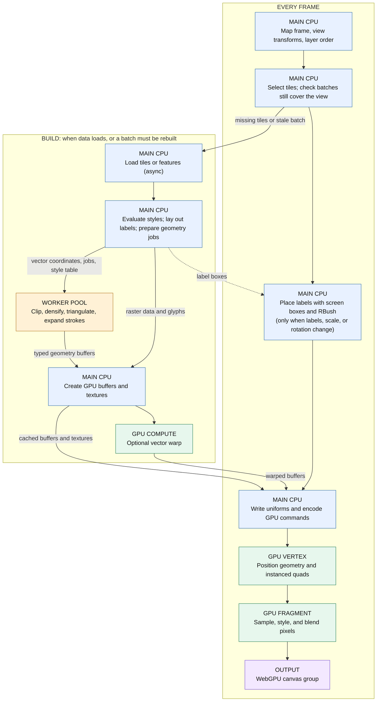

# WebGPU renderer architecture

The build stage does not run on every frame. Each tile is built once, after it
loads. A `WebGPUVector` batch is built for a padded extent and rebuilt only
when the view leaves that extent, the zoom crosses a level, or the source,
projection, pixel ratio, or style variables change. Between rebuilds, a frame
reuses the cached GPU buffers and textures and changes only uniforms and label
opacities.

The important boundary is that **rendering is not moved wholesale to a
worker**. Map state, sources, feature objects, style evaluation, text layout,
decluttering, WebGPU resource creation, and command submission all remain on
the main thread. A small worker pool handles the expensive, data-only part of
vector geometry construction. The GPU then performs projection-grid
interpolation, vertex placement, raster sampling, per-pixel styling, and
blending.

The three public layer types are:

- `WebGPUTile` for image and data tiles.
- `WebGPUVector` for a feature source.
- `WebGPUVectorTile` for tiled feature data.

All require WebGPU; there is no silent Canvas or WebGL fallback.

## Frame orchestration on the main thread

`Map` creates a `frameState` containing the view, extent, transforms, layer
order, pixel ratio, time, tile queue, and animation hints.
`renderer/Composite.js` calculates the map matrices, calls each visible layer
renderer in z-order, and runs a second, back-to-front label/deferred pass when
any layer requests decluttering.

`renderer/webgpu/Layer.js` is the common layer base. On the first usable frame
it requests the process-wide `GPUDevice`, creates a `WebGPUHelper`, and groups
compatible adjacent WebGPU layers onto a shared canvas. Device loss causes
the helper, pipelines, and GPU resources to be recreated.

For each draw, `webgpu/Helper.js`:

1. Sizes and configures the canvas for the frame's CSS size and pixel ratio.
2. Creates a command encoder and render pass.
3. Lets the layer bind pipelines, uniforms, vertex/index buffers, textures,
   and issue draw calls.
4. Ends and submits the commands immediately. Submission is not deferred
   because the current canvas texture cannot be held across the event loop.

Pipelines and bind groups are cached where their resources are stable.
Camera changes generally update small uniform buffers instead of rebuilding
geometry.

## What runs in a worker

The dedicated renderer worker is only used for vector geometry:

- `render/webgpu/workerPool.js` owns two lazily created workers shared by all
  WebGPU vector and vector-tile layers. A request goes to the worker with the
  fewest outstanding jobs.
- `worker/webgpuvector.js` calls the same
  `render/webgpu/geometryBuffers.js` code used by the main-thread fallback.
- Input coordinate and style `ArrayBuffer`s are transferred to the worker,
  not cloned. Completed fill, stroke, index, attribute, and style buffers are
  transferred back.

The worker performs the CPU geometry work that precedes a GPU draw:

- clipping lines and polygon rings;
- densifying edges where a curved projection needs more samples;
- polygon triangulation with `earcut`;
- rejecting invalid, folded, or projection-cut triangles;
- expanding each stroke segment to a four-vertex ribbon;
- quantizing positions into a batch-local signed 16-bit grid; and
- producing typed arrays ready for GPU upload.

The worker does **not** receive feature objects, style functions, the font
atlas, map state, or a GPU device.

Geometry falls back to the main thread when workers are unavailable, when a
request contains a non-cloneable projection function, or in paths where the
renderer deliberately builds an uncached/incomplete batch immediately.
Raster rendering has no renderer-owned worker stage. Tile loading or decoding
may itself be asynchronous, but that belongs to the tile source/loader rather
than this WebGPU renderer.

## What remains on the main CPU thread

### Vector preparation

`render/webgpu/buffers.js` walks feature objects and evaluates the layer's
style function at the build resolution. It sorts features for stable output
and builds:

- plain-data fill and stroke jobs for the worker;
- a compact color and hit-color style table;
- point-symbol instances;
- glyph instances and label collision boxes;
- label/image pair metadata; and
- references back to the original features for hit detection.

Vector flat styles are evaluated on the CPU and become ordinary OpenLayers
`Style` values before geometry is built. This differs from raster tile style
expressions, which are compiled into WGSL and evaluated in the fragment
shader.

Text is also prepared on the main thread. `FontAtlas.js` measures and
rasterizes glyphs with Canvas 2D, `glyphLayout.js` lays out point and line
labels, and the finished atlas is uploaded as a GPU texture.

`WebGPUVector` builds one buffered feature batch covering more than the
viewport and reuses it through ordinary pans and small zoom changes.
`WebGPUVectorTile` builds and caches one batch per render tile. While a tile's
worker job is pending, cached parent or child batches can fill the hole.

### Raster preparation

`WebGPUTile` chooses source tiles, maintains fallback/transition tiles, and
enqueues missing tiles through the map tile queue. `TileTexture.js` converts
loaded image or array tiles to GPU textures. One- to three-band arrays are
expanded to RGBA, rows are padded to WebGPU's alignment requirement, and
float tiles use an unfilterable `rgba32float` texture path.

The main thread also computes per-tile transforms, alpha transitions, depth,
render extents, bind groups, and uniforms. `getData()` reads from cached
source tile data on the CPU; it does not read the rendered canvas back from
the GPU.

### Labels and hit detection

Decluttering currently runs on the main thread. `LabelView.js` transforms
glyph and symbol bounds to CSS-pixel boxes. `declutter.js` sorts by priority,
keeps image/text pairs together, shares an `RBush` occupancy tree across
layers in a declutter group, and keeps stable symbol identities so winners do
not flip unnecessarily. Placement extends 100 CSS pixels beyond the viewport.

The resulting visibility targets are uploaded only when they change.
`labelFade.js` retains bidirectional fade state; glyph and symbol shaders
interpolate opacity from the uploaded start, target, and start time.

There is a `DECLUTTER_SHADER` and a `dispatchDeclutterCompute()` helper, but
the current layer renderers do not call it. The active placement path is the
CPU `resolveDeclutter()` path.

Vector feature queries are also CPU-side: point-symbol boxes are tested in
screen space and area geometries use geometry containment tests (with an
inverse projection where necessary). Text itself is intentionally not a hit
target.

## What runs in shaders

Shader source is collected in `webgpu/shaders.js`.

### Raster tile shaders

- The ordinary tile vertex shader transforms a tessellated tile quad to clip
  space and supplies texture and local map coordinates.
- The reprojection tile vertex shader receives already projected target
  positions from a CPU-built mesh and applies the current view matrix.
- Fragment shaders clip to the render extent, sample the tile texture, apply
  tile/layer transition alpha, and blend premultiplied color.
- `expr/wgsl.js` compiles tile color expressions into the fragment body, so
  operations such as band math, palettes, and style variables execute per
  pixel on the GPU.

### Vector compute and render shaders

- Normal vector batches use signed 16-bit local positions. Fill and stroke
  vertex shaders apply a local-grid-to-clip matrix.
- Reprojected `WebGPUVector` batches first run `VECTOR_WARP_SHADER`, a compute
  shader. It bilinearly interpolates a sampled projection grid for every
  vertex, marks invalid/cut cells, and transforms stroke normals with the
  local projection Jacobian. This happens when the batch/grid is created, not
  on every frame.
- Fill vertex shaders position triangle vertices and fetch color by style
  index.
- Stroke vertex shaders expand the CPU-generated ribbon normal in screen
  pixels. Subpixel strokes are widened to one pixel and their alpha is reduced
  to preserve coverage.
- Symbol and glyph vertex shaders instance screen-aligned quads at world
  anchors and apply the fade transition.
- Fragment shaders select normal or hit color, apply global opacity, sample
  the glyph atlas where needed, and output premultiplied color.

The vector shaders contain a hit-color branch, but current feature queries do
not render and read back a GPU hit target; the active query path is the CPU
path described above.

## Reprojection split

Raster and vector reprojection use different preparations.

### Raster tiles

The main thread estimates which native source tiles cover the view and
selects a source-grid zoom. `webgpu/reproj.js` builds and caches a triangular
mesh for each source tile. A mesh vertex contains:

- a target/view-projection position; and
- the matching source-tile texture coordinate.

Projection calls and adaptive mesh refinement happen on the CPU. Invalid
areas and triangles crossing projection cuts are omitted. The GPU vertex
shader only applies the current view matrix to the prepared target position,
while the fragment shader samples the unchanged source texture.

### Plain vectors

Feature coordinates stay in the source projection. The main thread samples
the source-to-view transform into an adaptive `warpGrid.js` grid, using real
projection calls only at grid nodes and error probes. The worker tessellates
source geometry with that grid available for densification and cut
filtering. After upload, the vector warp compute shader interpolates the grid
for every vertex and writes reusable target-projection buffers.

Label anchors are few enough that they are projected directly on the main
thread during label construction. The current `WebGPUVectorTile` path does
not use the plain-vector warp compute stage.

## Files to start with

- `src/ol/renderer/Composite.js` — frame/layer ordering and deferred label
  pass.
- `src/ol/renderer/webgpu/Layer.js` — device/helper lifecycle.
- `src/ol/webgpu/Helper.js` — GPU resources, passes, pipeline caches, submit.
- `src/ol/renderer/webgpu/TileLayer.js` — raster selection and drawing.
- `src/ol/renderer/webgpu/VectorLayer.js` — feature-batch lifecycle.
- `src/ol/renderer/webgpu/VectorTileLayer.js` — tiled vector batches.
- `src/ol/render/webgpu/buffers.js` — main-thread style/feature/label
  preparation.
- `src/ol/render/webgpu/geometryBuffers.js` — worker-compatible tessellation.
- `src/ol/render/webgpu/workerPool.js` and `src/ol/worker/webgpuvector.js` —
  worker boundary.
- `src/ol/renderer/webgpu/vectorUtil.js` — GPU vector buffers and pipelines.
- `src/ol/webgpu/reproj.js` and `src/ol/render/webgpu/warpGrid.js` —
  reprojection preparation.
- `src/ol/webgpu/shaders.js` — WGSL compute, vertex, and fragment programs.
- `src/ol/renderer/webgpu/LabelView.js`,
  `src/ol/render/webgpu/declutter.js`, and
  `src/ol/renderer/webgpu/LabelRenderer.js` — label placement and drawing.
